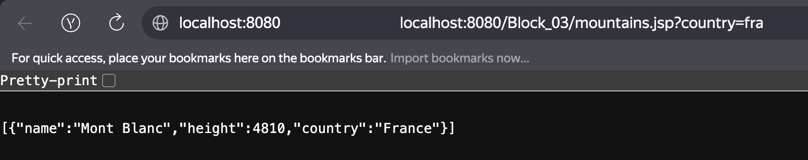
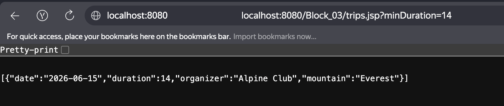
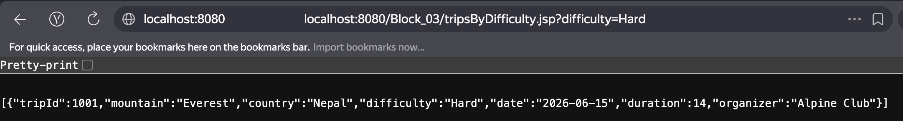
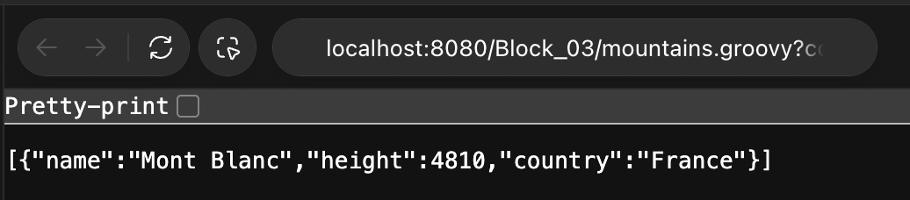
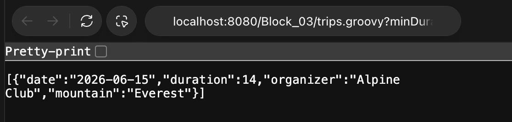
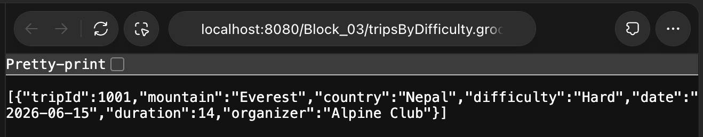

# Block 03 — Back-End Programming with JSP and Groovy

В этой работе я перенесла функциональность Block 01 и Block 02 на JSP и Groovlet. Обработчики получают параметры HTTP-запроса, выполняют SQL-запросы к PostgreSQL и возвращают JSON.

## Используемые технологии

- Java 21, Apache Tomcat 10.1.
- JSP и Groovy 5.0.1 (Groovlet).
- PostgreSQL и JDBC Driver 42.7.7.
- `groovy.json.JsonOutput` для формирования JSON в Groovlet.

## Реализованная функциональность

Каждый запрос реализован в двух вариантах: JSP и Groovlet.

| Запрос | Параметр | JSP | Groovlet |
| --- | --- | --- | --- |
| Горы по стране: поиск по подстроке без учёта регистра | `country` | `mountains.jsp` | `mountains.groovy` |
| Походы с продолжительностью не меньше заданной | `minDuration` | `trips.jsp` | `trips.groovy` |
| Походы по сложности горы | `difficulty` | `tripsByDifficulty.jsp` | `tripsByDifficulty.groovy` |

Параметры передаются в URL. SQL-запросы выполняются через `PreparedStatement`. Если совпадений нет, возвращается пустой массив `[]`. Для этих примеров параметры необходимо передавать явно; `minDuration` должен быть целым числом. Пользовательская обработка ошибок не добавлена.

## Структура проекта

```text
Block_03/
├── src/                    # SQL-дамп и исходники предыдущих сервлетов
├── screenshots/            # Скриншоты результатов
└── webapp/
    ├── mountains.jsp
    ├── trips.jsp
    ├── tripsByDifficulty.jsp
    ├── mountains.groovy
    ├── trips.groovy
    ├── tripsByDifficulty.groovy
    ├── hello.groovy         # Проверка запуска Groovlet
    └── WEB-INF/
        ├── web.xml         # Сопоставление *.groovy с GroovyServlet
        ├── lib/            # PostgreSQL JDBC и библиотеки Groovy
        └── classes/        # Скопированные классы Block 02
```

## База данных

Используется база `mountain_trekking` с таблицами `mountains`, `trips`, `hikers` и `participants`. Для запросов этой работы используются `mountains` и `trips`. Дамп находится в [src/database.sql](src/database.sql).

## Развёртывание и запуск

1. Подготовить PostgreSQL и восстановить таблицы и данные из `src/database.sql`.
2. Указать свои параметры подключения в JSP и Groovlet.
3. Скопировать содержимое `webapp` в каталог `webapps/Block_03` установленного Tomcat.
4. Запустить Tomcat. Библиотеки находятся в `WEB-INF/lib`, настройка GroovyServlet — в `WEB-INF/web.xml`.
5. Открыть примеры ниже. По умолчанию используется `http://localhost:8080`.

## Результаты JSP

### Горы по стране

Запрос: `http://localhost:8080/Block_03/mountains.jsp?country=fra`



### Походы по продолжительности

Запрос: `http://localhost:8080/Block_03/trips.jsp?minDuration=14`



### Походы по сложности

Запрос: `http://localhost:8080/Block_03/tripsByDifficulty.jsp?difficulty=Hard`



## Результаты Groovlet

### Горы по стране

Запрос: `http://localhost:8080/Block_03/mountains.groovy?country=fra`



### Походы по продолжительности

Запрос: `http://localhost:8080/Block_03/trips.groovy?minDuration=14`



### Походы по сложности

Запрос: `http://localhost:8080/Block_03/tripsByDifficulty.groovy?difficulty=Hard`


