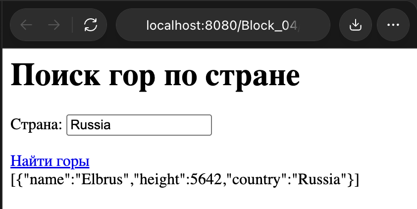
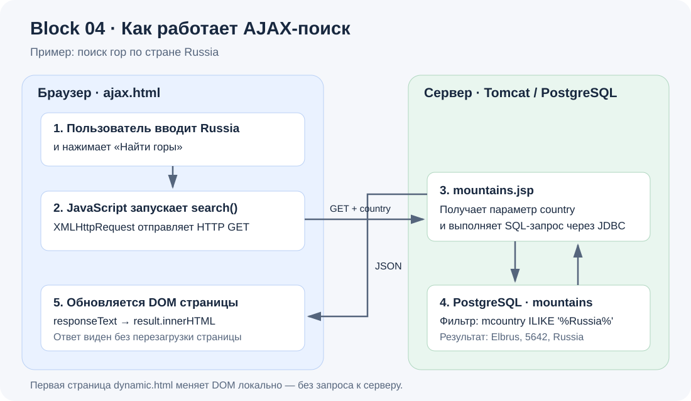

# Block 04 — Front-End Programming and AJAX Architecture

В этой работе я создала две HTML-страницы с JavaScript: первая изменяет содержимое страницы по нажатию ссылки, вторая получает данные из базы через JSP и показывает ответ без перезагрузки страницы.

## Реализованные страницы

### 1. Изменение HTML — dynamic.html

По нажатию ссылки «Показать описание» вызывается функция `modify()`. Она находит блок `contentLevel2_1` через `document.getElementById()` и заменяет его содержимое через `innerHTML`. Запрос к серверу не нужен.

### 2. AJAX-поиск — ajax.html

Пользователь вводит страну и нажимает «Найти горы». Функция `search()` читает поле формы и отправляет асинхронный GET-запрос через `XMLHttpRequest` в `mountains.jsp`. После завершения запроса (`readyState == 4`) с успешным статусом (`status == 200`) ответ `responseText` вставляется в блок `result` через `innerHTML`.

Страница показывает исходный JSON, полученный от сервера. Например, для `Russia` возвращаются название горы Elbrus, высота 5642 и страна Russia.



### 3. Backend — mountains.jsp

Используется обработчик из Block 03. Он получает параметр `country`, подключается к PostgreSQL через JDBC и выполняет параметризованный запрос:

```sql
SELECT mname, mheight, mcountry
FROM mountains
WHERE mcountry ILIKE ?
```

В параметр запроса передаётся строка `%страна%`: поиск выполняется по подстроке без учёта регистра. Ответ имеет тип `application/json`; если совпадений нет, возвращается `[]`.

## Схема системы



## Технологии и материалы

- HTML и JavaScript: формы, DOM, `getElementById`, `innerHTML`.
- AJAX: `XMLHttpRequest`, GET, `onreadystatechange`, `responseText`.
- JSP, Apache Tomcat 10, PostgreSQL и JDBC Driver 42.7.7.
- Редактор Zed и терминал Ghostty.

Приёмы основаны на разделах **AJAX → Document Object Model → Inner HTML** и **XMLHTTP** в [учебнике курса](https://scerbakov.com:8443/wbtmaster/courses/is8_starte.htm). В AJAX-примере используется `XMLHttpRequest` без устаревшего `ActiveXObject`.

## Структура проекта

```text
Block_04/
├── README.md
├── images/
│   ├── ajax-result.png
│   └── ajax-system.svg
└── webapp/
    ├── dynamic.html
    ├── ajax.html
    ├── mountains.jsp
    └── WEB-INF/
        └── lib/
            └── postgresql-42.7.7.jar
```

## Запуск

1. Запустить PostgreSQL с базой `mountain_trekking` из Block 03. Параметры подключения находятся в `mountains.jsp`.
2. Скопировать содержимое `webapp` в `webapps/Block_04` установленного Tomcat.
3. Запустить Tomcat и открыть страницы:
   - `http://localhost:8080/Block_04/dynamic.html`
   - `http://localhost:8080/Block_04/ajax.html`
4. На странице поиска указать `Russia` или `France` и нажать «Найти горы».

Для AJAX страницу нужно открывать через Tomcat, а не как локальный файл. Проверить backend отдельно можно по адресу `http://localhost:8080/Block_04/mountains.jsp?country=France`.

## Файлы для сдачи

По условию задания архив `Block_04.zip` содержит три исходных файла: `dynamic.html`, `ajax.html` и `mountains.jsp`. README, скриншот и схема служат документацией проекта.
