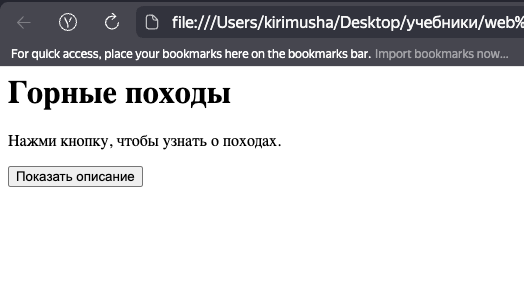
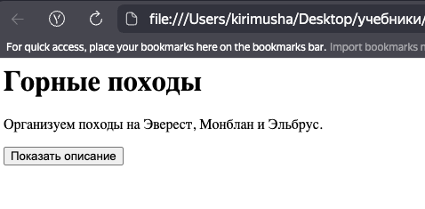
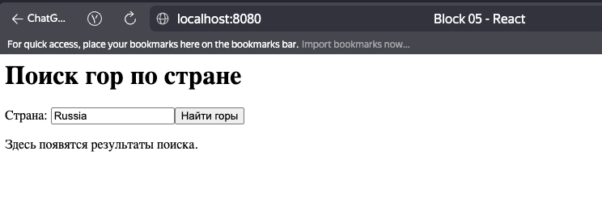
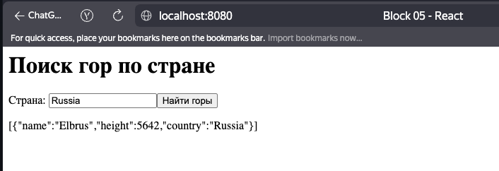

# Block 05 — Front-End Programming with React

В пятом блоке я переделала две страницы из Block 04 на React. На первой по кнопке появляется описание походов, на второй можно найти горы по стране. Результат поиска появляется на той же странице.

## Что использовала

- React 18.2.0 и ReactDOM, подключённые через CDN.
- JSX и Babel для выполнения примеров непосредственно в HTML.
- `React.useState`, обработчики `onClick` и `onChange`.
- Fetch API для получения JSON от JSP.
- JSP из предыдущего блока, Tomcat 10 и PostgreSQL.

## 1. Изменение описания — dynamic.html

В компоненте `App` текст хранится в состоянии `description`. Кнопка «Показать описание» вызывает `setDescription()` и меняет текст. React сам обновляет абзац на странице.

До нажатия:



После нажатия:



## 2. Поиск гор — ajax.html

В `country` хранится введённая страна, в `result` — ответ сервера. При вводе текста `onChange` обновляет `country`. Кнопка «Найти горы» запускает `search()`:

```javascript
fetch("mountains.jsp?country=" + encodeURIComponent(country))
    .then(response => response.json())
    .then(data => setResult(JSON.stringify(data)));
```

Сначала `response.json()` разбирает ответ сервера. Затем `JSON.stringify()` превращает данные в строку, а `setResult()` сохраняет её в состоянии. React показывает результат под кнопкой без перезагрузки страницы.

До запроса:



После запроса для Russia:



## Как связаны части системы

```text
Браузер: React-компонент App
  → нажатие «Найти горы»
  → fetch: GET mountains.jsp?country=Russia
  → Tomcat выполняет JSP
  → JDBC-запрос к PostgreSQL
  → JSON с результатами
  → setResult обновляет состояние
  → React показывает результат на странице
```

Для поиска я оставила `mountains.jsp` из предыдущего блока. Он обращается к PostgreSQL и возвращает JSON. Страна ищется по части названия без учёта регистра через `ILIKE`. Например, для `Russia` приходит Elbrus с высотой 5642. Если запрос завершится с ошибкой, отдельного сообщения на странице пока нет.

## Файлы

```text
Block_05/
├── Block_05.zip          # Два frontend-файла для сдачи
├── README.md
├── images/              # Скриншоты до и после действий
└── webapp/
    ├── dynamic.html
    ├── ajax.html
    ├── mountains.jsp
    └── WEB-INF/lib/
        └── postgresql-42.7.7.jar
```

## Запуск

1. Запустить PostgreSQL с базой `mountain_trekking` из предыдущих блоков. При необходимости изменить параметры подключения в `mountains.jsp`.
2. Скопировать содержимое `webapp` в `webapps/Block_05` установленного Tomcat.
3. Запустить Tomcat и открыть:
   - `http://localhost:8080/Block_05/dynamic.html`
   - `http://localhost:8080/Block_05/ajax.html`
4. На первой странице нажать «Показать описание», на второй — ввести страну и нажать «Найти горы».

React и Babel загружаются с CDN, поэтому нужен интернет. Страницу поиска нужно открывать через Tomcat, чтобы она могла обратиться к JSP.

В `Block_05.zip` для сдачи лежат два frontend-файла: `dynamic.html` и `ajax.html`. JSP и драйвер базы остались в рабочем проекте.

## Материалы курса

При написании кода я использовала разделы React Basics, JSX and Babel, React Function State, React Events, React Forms и React Communication из [учебника курса](https://scerbakov.com:8443/wbtmaster/courses/is8_starte.htm).

В примерах встречается старый `ReactDOM.render()`. Здесь подключён React 18, поэтому для вывода компонента используется `ReactDOM.createRoot()`.
